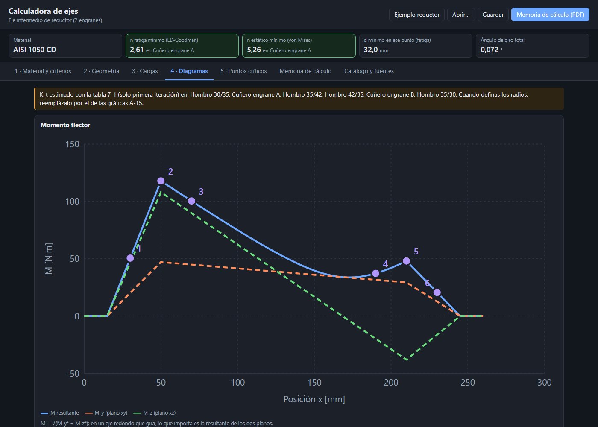
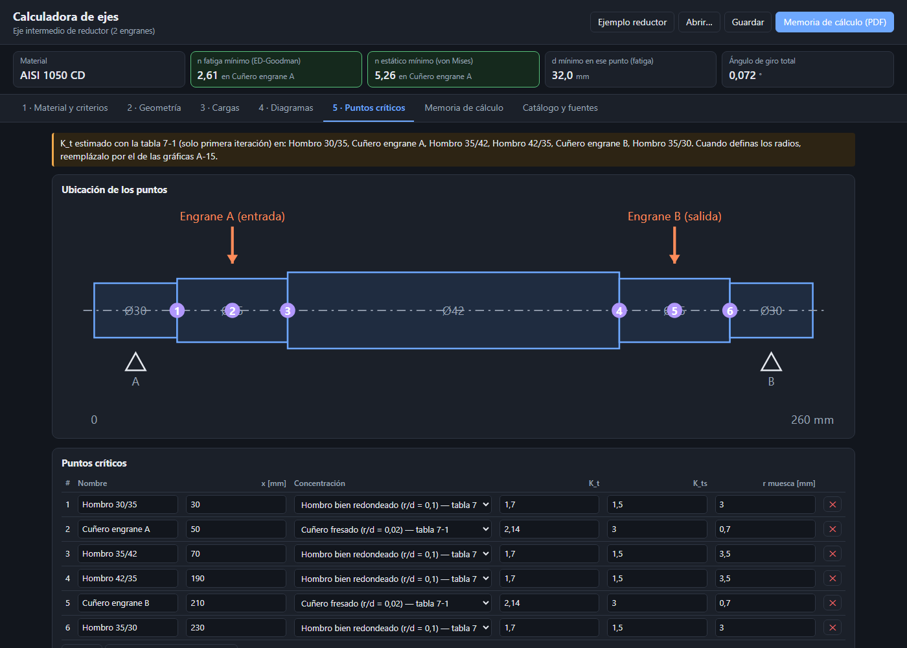
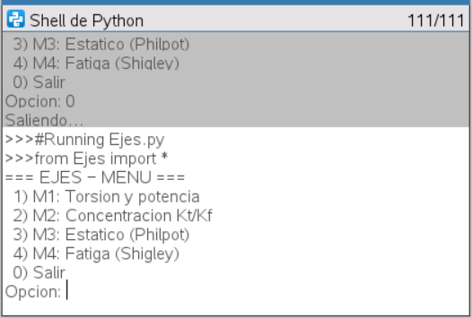
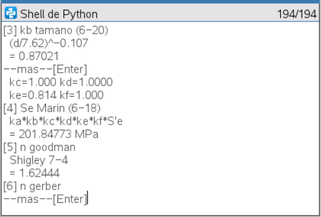
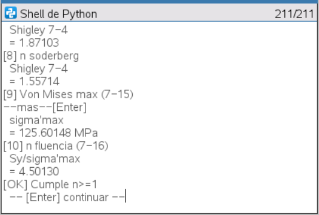
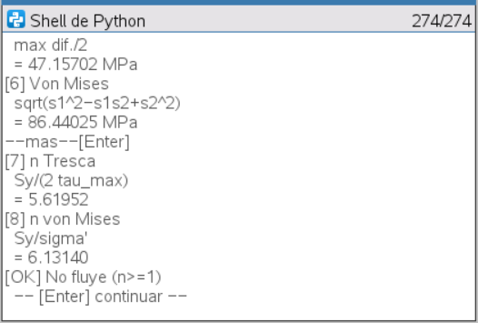

# Calculadora de ejes

Herramienta para diseñar y verificar ejes de transmisión con dos miradas sobre el
mismo eje:

- **Estático (Resistencia de Materiales, Philpot):** esfuerzos en la superficie,
  esfuerzos principales, teorías de Tresca y von Mises, torsión, ángulo de giro y
  potencia.
- **Fatiga (Diseño Mecánico, Shigley):** límite de fatiga con los factores de
  Marin, concentración de esfuerzos K_f por Neuber y los criterios ED-Goodman,
  ED-Gerber, ED-ASME elíptico y ED-Soderberg, con el diámetro mínimo para un
  factor de seguridad.

Viene en dos versiones con el **mismo núcleo de cálculo**: una web para el eje
completo y un programa para la calculadora TI-Nspire CX II que revisa un punto
crítico paso a paso.

**[Abrir la versión web](https://fflores96.github.io/calculadora-ejes/)**



## Versión web

| Pestaña | Qué hace |
|---|---|
| Material y criterios | Acero de la tabla A-20 o S_ut y S_y a mano, factores de Marin, criterio de fatiga, factor de seguridad objetivo |
| Geometría | Tramos de distinto diámetro y dos apoyos, con esquema a escala |
| Cargas | Fuerzas en los dos planos y torques; ayudas para fuerzas de engrane y torque desde la potencia; reacciones |
| Diagramas | Momento en cada plano y resultante, torque y corte |
| Puntos críticos | Hombros, cuñeros y ranuras con su K_t; n estático y a fatiga; diámetros mínimos |
| Memoria de cálculo | Todo el desarrollo por punto, con fuentes, imprimible en PDF |



El ejemplo incluido es el eje intermedio de un reductor con dos engranes. Muestra
algo que suele pasar inadvertido: el punto crítico (el cuñero del engrane de
entrada) tiene un factor de seguridad estático de 5,3, pero a fatiga baja a 2,6.

Abre `index.html` con doble clic o la versión publicada. No usa librerías
externas: funciona sin internet. Los casos se guardan y se abren como `.json`.

## Versión TI-Nspire CX II

`ti-nspire/ejes.py`, en MicroPython, con cuatro módulos encadenables:

| Módulo | Cálculo |
|---|---|
| M1 | Torsión y potencia: τ = Tc/J, ángulo de giro, T desde P y rpm |
| M2 | K_t (tabla 7-1 o gráficas) y K_f por la sensibilidad a la muesca de Neuber |
| M3 | Punto crítico estático: principales, Tresca, von Mises, diámetro mínimo |
| M4 | Fatiga: factores de Marin, los 4 criterios, fluencia, diámetro mínimo iterado |

| Menú | M4: Marin y criterios | M4: fluencia y verificación | M3: estático |
|---|---|---|---|
|  |  |  |  |

Las capturas de M4 son el **Ejemplo 7-1 de Shigley** convertido a SI (d = 27,94 mm,
M_a = 142,4 N·m, T_m = 124,3 N·m): el programa da n = 1,62 / 1,86 / 1,87 / 1,56
según el criterio y n_y = 4,50, como el libro (1,63 / 1,87 / 1,88 / 1,56 y 4,50).

Para cargarlo: en TI-Nspire CX Student Software, nuevo documento, Insertar →
Python → Nuevo, pegar el contenido de `ejes.py`, Ctrl+B y Ctrl+R. Todos los
submenús tienen "0) Volver".

## Estructura

| Carpeta | Contenido |
|---|---|
| `nucleo/` | `ejes.py` (núcleo de referencia en Python) y `pruebas.py` |
| `ti-nspire/` | `interfaz.py`, `construir.py` y el programa armado `ejes.py` |
| `js/`, `css/`, `index.html` | Versión web (el núcleo traducido a JavaScript) |
| `pruebas.html` | Pruebas de la versión web |

`ti-nspire/construir.py` arma el programa de la calculadora uniendo el núcleo y la
interfaz, para que el código de cálculo sea el mismo que se prueba en el PC.

## Pruebas

```bash
python nucleo/pruebas.py
```

y `pruebas.html` en el navegador (30 pruebas). Reproducen:

- Shigley 9.ª ed., ejemplos 6-3 (k_a), 6-4 (k_b), 6-6 (K_f por Neuber) y 7-1 (los
  cuatro criterios de fatiga y la fluencia).
- Philpot 4.ª ed., ejemplo 6.6 (torque desde la potencia y esfuerzo cortante).
- Casos de viga calculados a mano: carga central, voladizo, resultante en dos
  planos, torque entre engranes y ángulo de giro.

Al verificar se encontró que la forma 1,24·d^(−0,107) de la ec. (6-20) de Shigley
trae el coeficiente redondeado; la calculadora usa (d/7,62)^(−0,107), que es la que
el propio libro aplica en el ejemplo 6-4.

## Fuentes y límites

- Budynas y Nisbett (2012). *Diseño en ingeniería mecánica de Shigley*, 9.ª ed.
  McGraw-Hill: ec. 6-8 a 6-35, tablas 6-2, 6-5, 7-1, A-5 y A-20, ec. 7-1 a 7-16.
- Philpot, T. A. (2017). *Mechanics of Materials*, 4.ª ed. Wiley: sec. 6.3-6.8,
  15.4 y 15.5.

Los K_t de la tabla 7-1 son estimaciones de primera iteración; los de las gráficas
A-15 se ingresan a mano. La versión web considera dos apoyos simples, cargas
puntuales y sin carga axial. Deflexión, velocidad crítica y cuñas quedan para una
próxima versión. Los valores de catálogo son referenciales.

## Autor

Felipe Flores Díaz, estudiante de Ingeniería en Ejecución Mecánica, Universidad de
Santiago de Chile. Desarrollado con asistencia de IA (Claude Code); los criterios
de ingeniería, la verificación y la elección de fuentes son míos.
